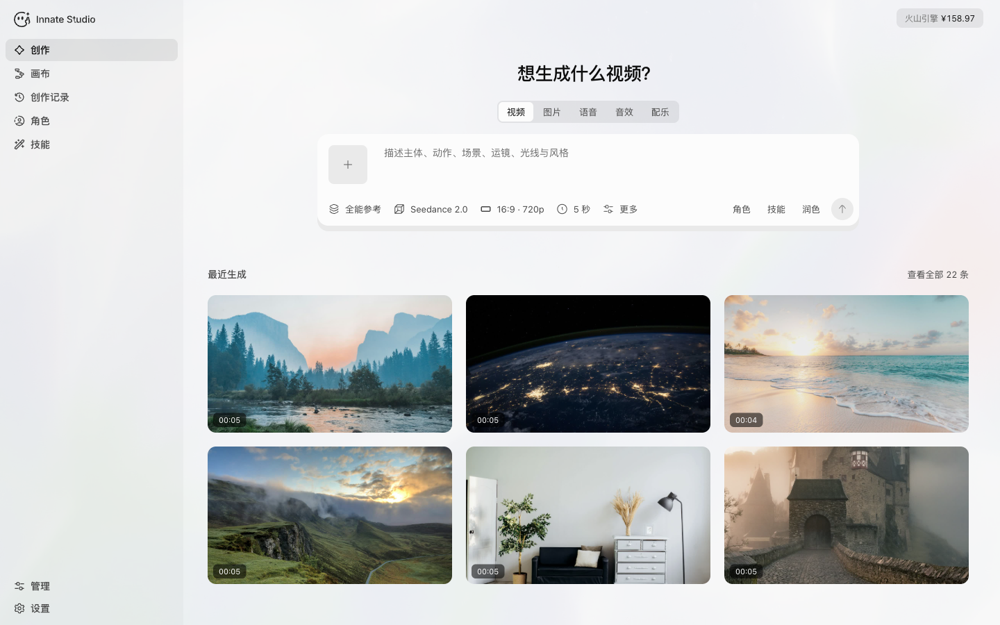
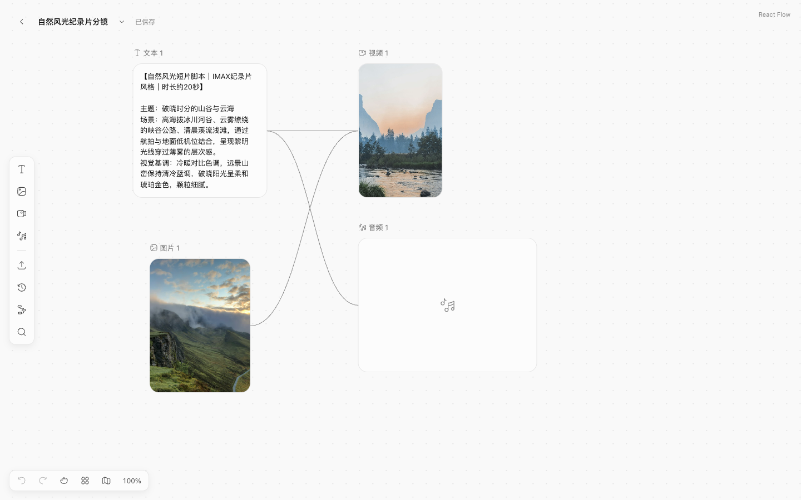
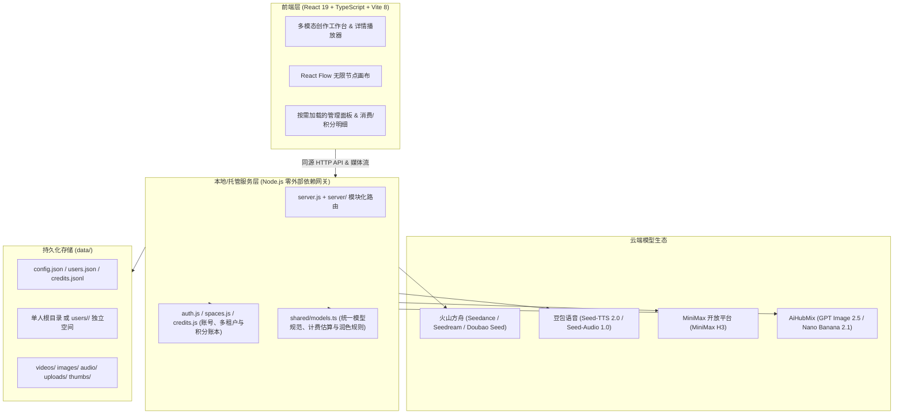

<div align="center">

<p align="center">
  <picture>
    <source media="(prefers-color-scheme: dark)" srcset="docs/screenshots/logo-dark.svg" />
    <source media="(prefers-color-scheme: light)" srcset="docs/screenshots/logo-light.svg" />
    
  </picture>
</p>

### 本地优先、支持团队托管的 AIGC 多模态创作工作台
*A local-first & team-ready multimodal generative AI workbench powered by Seedance 2.5/2.0, MiniMax H3, Seedream 5.0, GPT Image 2.5, Nano Banana 2.1, Doubao Speech & Infinite Node Canvas.*

[](LICENSE)
[](https://nodejs.org)
[](https://react.dev)
[](https://vitejs.dev)
[](https://reactflow.dev)

[功能特性](#-功能特性) • [模型矩阵](#-多平台与模型矩阵) • [快速开始](#-快速开始) • [多人模式与部署](#-多人团队模式与部署) • [架构与存储](#-系统架构与数据存储) • [开发者指南](#-开发者指南)

</div>

---

> **设计理念**：工作台美学（深度对标 Google Antigravity 2.0 与 OpenAI Codex）。**原生支持深浅双主题与跟随系统自适应切换**。侧栏纯粹导航，居中一体化创作输入框，全局采用低对比层次与系统无衬线排版。界面本身保持克制中性，将所有视觉焦点留给生成内容本身。

---

## 📸 界面预览

> 🌗 **自适应双色主题**：下方配图会根据您当前 GitHub 的浅色 / 深色模式自动切换。

<p align="center">
  <picture>
    <source media="(prefers-color-scheme: dark)" srcset="docs/screenshots/workbench-dark.png">
    <source media="(prefers-color-scheme: light)" srcset="docs/screenshots/workbench-light.png">
    
  </picture>
</p>
<p align="center"><em>多模态创作工作台：视频、图片、语音、音效、配乐五合一输入框与最近生成流</em></p>

<br />

<p align="center">
  <picture>
    <source media="(prefers-color-scheme: dark)" srcset="docs/screenshots/canvas-dark.png">
    <source media="(prefers-color-scheme: light)" srcset="docs/screenshots/canvas-light.png">
    
  </picture>
</p>
<p align="center"><em>无限节点画布（React Flow）：文本、图片、视频、音频多节点自由拓扑、@ 引用与工作流复用</em></p>

---

## ✨ 功能特性

### 1. 🌌 无限节点画布 (Infinite Node Canvas)
- **全要素自由拓扑**：基于 `@xyflow/react` 构建，提供**文本、图片、视频、音频**四种原生节点，支持拖拽连线驱动生成：
  - **文本 ➔ 视频 / 图片 / 音频**：传递为生成提示词，或驱动下游文本节点继续扩写。
  - **图片 ➔ 视频**：作为全能参考图、首帧或尾帧。
  - **图片 ➔ 图片**：多参考图融合与图生图迭代。
  - **视频 / 音频 ➔ 视频**：作为全能参考素材（动作、运镜、节奏或参考音）。
- **提示词 `@` 引用与 `/` 斜杠预设**：
  - 在画布输入面板中输入 `@` 即可将已连接的上游节点（如 `@图片 1`、`@文本 1`）插入提示词并原地高亮；悬停参考格即可双向定位上游节点与连线。
  - 图片节点支持 `/` 斜杠预设（多机位九宫格、剧情推演四宫格、角色三视图、角色设定图、画面推演、电影级光影、故事板）。
- **视频续拍与图像本地工具**：
  - **视频节点**：支持一键截取当前帧 / 首帧 / 尾帧为图片节点，或一键「接着拍」（自动截取尾帧并串联新视频节点续拍）。
  - **图片节点**：内置交互式自由/定比裁剪、2×2 / 3×3 / 4×4 宫格切图（配合九宫格预设快速拆镜）以及按比例 AI 扩图。
- **分组执行、工作流与堆叠收纳**：
  - 支持框选批量操作（批量生成、对齐分布、打组 `⌘G`、堆叠收纳、跨画布复制粘贴）；
  - 分组支持一键「执行整组」（按连线拓扑从上游到下游依次生成）与「存为工作流」跨项目复用；
  - 支持四色节点标记与顶栏汇总跳转、自动拓扑整理节点及参考线磁吸对齐。

### 2. 🎥 全模态创作矩阵 (Multimodal Workbench)
- **电影级视频生成 (Video)**：
  - **Seedance 2.5 / 2.0 / 2.0 Fast / 2.0 Mini**（火山方舟）：支持文生视频、首尾帧控制、全能参考（最多 9 张图片 + 3 段视频 + 3 段本机音频混合输入），Seedance 2.5 最长支持 30 秒生成，2.0 支持最高 4K 分辨率。
  - **MiniMax H3 / H3 Max**（MiniMax 开放平台）：支持 480P / 768P / 2K 视频生成、首尾帧与全能参考输入。
- **专业图像生成 (Image)**：
  - **Seedream 5.0 Pro / Flash / 标准版**（火山方舟）：支持 1K / 1.5K / 2K / 3K / 4K 多档分辨率与最高 14 张参考图输入。
  - **GPT Image 2.5 (Sunburst / Flare)** & **Nano Banana 2.1**（AiHubMix）：支持最高 4K 分辨率、多档画质控制与最多 16 张参考图输入。
- **全链路声音生成 (Speech, SFX & Music)**：
  - **自然语音合成 (TTS)**：基于豆包语音合成 2.0（`Seed-TTS 2.0`），内置中英及多语种音色筛选与实时试听。
  - **环境音效 (SFX)** & **智能配乐 (Music)**：基于豆包音频生成 1.0（`Seed-Audio 1.0`），支持按描述生成拟真音效，或上传视频自动生成配乐并在播放器中声画同轨预览。

### 3. 🎭 角色库与提示词技能 (Characters & Skills)
- **角色一致性档案**：持久化保存角色名称、外貌描述与最多 6 张参考图；创作时一键带入参考图与外貌描述，保持多镜头角色形象稳定。
- **提示词技能库 (Skills)**：内置「多镜头成片」「角色设定图」「分镜首帧」等官方技能，支持创建自定义技能与标签筛选。
- **模型自适应润色**：基于 `Doubao Seed 2.1` 文本模型，根据当前所选生成模型（Seedance 2.5 时间戳分镜规范、Seedance 2.0 运镜与音效标记、Seedream 图生图指令、语音朗读断句规范、音效/配乐描述规范）精准改写提示词，并支持一键撤销。

### 4. 👥 本机优先与多人团队双模式 (Local-First & Team Hosted)
- **本机模式（默认）**：零外部运行时依赖，无需登录，所有配置、生成记录与媒体文件 100% 存储在本地 `data/` 目录。
- **多人团队模式**：通过命令行创建账号后自动启用登录认证与多租户空间隔离：
  - **数据隔离**：每位成员的创作记录、画布、角色、技能与媒体文件独立存储。
  - **积分核算**：`1 积分 = 0.01 元`（按官方目录价 1:1 折算），提交时预扣积分、完成后按实际用量多退少补、失败全额自动退回。
  - **权限分层**：「设置」与「管理」分离——API Key、三方平台余额（火山引擎 / MiniMax / AiHubMix）、平台原始报错及成员积分管理仅对管理员可见。

---

## ⚖️ 多平台与模型矩阵

Innate Studio 以**火山引擎**为主线，同时接入 **MiniMax** 与 **AiHubMix**。各平台 API Key 在侧栏底部的「管理」面板（或环境变量）中独立配置，配好哪个即可使用对应模型：

| 平台 | 配置项 / 环境变量 | 涵盖能力 | 支持模型 |
| :--- | :--- | :--- | :--- |
| **火山方舟** | `ARK_API_KEY` | 视频生成、图片生成、提示词润色、画布文本节点 | `Seedance 2.5`、`Seedance 2.0 / Fast / Mini`<br>`Seedream 5.0 Pro / Flash / 5.0`<br>`Seed 2.1 Lite / Turbo / Pro` |
| **豆包语音** | `DOUBAO_SPEECH_API_KEY` | 语音合成 (TTS)、环境音效 (SFX)、视频配乐 (Music) | `Seed-TTS 2.0`<br>`Seed-Audio 1.0` |
| **MiniMax** | `MINIMAX_CN_API_KEY` | 视频生成（文生视频、首尾帧、全能参考） | `MiniMax H3`、`MiniMax H3 Max` |
| **AiHubMix** | `AIHUBMIX_API_KEY`<br>`AIHUBMIX_MANAGE_KEY`*(查余额)* | 图片生成（文生图、多图参考）、账户余额查询 | `GPT Image 2.5 Sunburst`<br>`GPT Image 2.5 Flare`<br>`Nano Banana 2.1` |
| **火山费用中心** | `VOLC_ACCESS_KEY_ID`<br>`VOLC_SECRET_ACCESS_KEY` | 火山引擎账户实时余额查询 | — |

---

## 🚀 快速开始

### 运行环境
- **Node.js**：`>= 22.18`（服务端直接使用 Node.js 原生支持运行共享的 TypeScript 模型定义文件 `shared/models.ts`）

### 安装与启动（本机模式）

```bash
# 1. 克隆仓库
git clone https://github.com/realruian/innate-studio.git
cd innate-studio

# 2. 安装依赖、构建前端并启动服务
npm install
npm start
```

启动后在浏览器打开：**`http://127.0.0.1:5178`**。点击左下角「管理」即可填写各平台 API Key。

> 💡 **环境变量注入（无痕模式）**：若不想在 `data/config.json` 中落盘保存密钥，可通过环境变量直接启动：
> ```bash
> ARK_API_KEY=... DOUBAO_SPEECH_API_KEY=... MINIMAX_CN_API_KEY=... AIHUBMIX_API_KEY=... npm start
> ```
> 如需修改监听端口或数据目录：
> ```bash
> PORT=5180 INNATE_DATA_DIR=/path/to/data npm start
> ```

---

## 👥 多人团队模式与部署

当数据目录中存在至少一个账号时，服务会自动从「本机模式」切换为「多人模式」，要求登录后访问。

### 账号与积分管理 CLI (`npm run user`)

> ⚠️ **注意**：在执行 `npm run user` 修改账号前请先停止正在运行的服务，或确保修改后账号状态同步。首个管理员账号只能通过命令行创建。

```bash
# 创建首个管理员账号，并将原本机模式下的数据迁移至该账号名下
npm run user -- add alice --admin --with-local-data

# 创建普通成员账号（可指定密码，不指定则随机生成一次性初始密码）
npm run user -- add bob --password <密码>

# 为成员发放积分（100 积分 = 1 元，支持负数扣回）
npm run user -- grant bob 5000

# 重置成员密码
npm run user -- reset bob

# 查看所有账号状态与积分余额
npm run user -- list
```

管理员登录后，也可直接在界面左下角「管理 ➔ 成员」中新建成员、发放积分、重置密码或停用账号，并查看团队总积分与当月总用量。

### 服务器生产部署 (`deploy/`)

仓库 `deploy/` 目录内置了开箱即用的生产环境配置模板：
- [`deploy/env.example`](deploy/env.example)：服务器环境变量密钥配置文件模板（建议置于 `/etc/innate-studio.env` 并设置 `chmod 600`）。
- [`deploy/innate-studio.service`](deploy/innate-studio.service)：`systemd` 守护进程配置（含 `ProtectSystem=strict` 等最小权限沙箱隔离）。
- [`deploy/Caddyfile`](deploy/Caddyfile)：Caddy 反向代理与自动 HTTPS 证书配置（转发至 `127.0.0.1:5178`，放开 70MB 请求体上限以支持 64MB 参考素材上传）。

---

## 🧱 系统架构与数据存储

### 架构全景



### 数据目录规范 (`data/`)

所有应用数据均保存在 `data/` 目录（可通过 `INNATE_DATA_DIR` 自定义）：

| 文件 / 目录 | 内容说明 |
| :--- | :--- |
| `data/config.json` | 平台 API Key 与计费配置（环境变量优先） |
| `data/users.json` / `sessions.json` | 多人模式下的账号信息（scrypt 加盐散列）与登录会话 |
| `data/credits.jsonl` | 多人模式下的积分变动流水账本（发放、预扣、结算、退回） |
| `data/users/<id>/` | 多人模式下每位成员的独立数据空间（结构与下方单人模式一致） |
| `data/history.json` | 历史生成任务、参数、用量及状态记录 |
| `data/canvases.json` | 无限画布工程数据（节点拓扑、连线、分组、堆叠与视口状态） |
| `data/workflows.json` | 画布中保存的可复用节点工作流模板 |
| `data/characters.json` | 角色库档案（名称、外貌设定及参考图关联） |
| `data/skills.json` | 用户自定义的提示词工程技能 |
| `data/videos/` `images/` `audio/` | 生成完成自动落盘保存的视频、图像与音频文件 |
| `data/uploads/` `thumbs/` | 用户上传的参考素材与自动生成的列表缩略图 |

---

## 🛠️ 开发者指南

### 常用命令

```bash
# 启动 Vite 前端热更新开发服务器（API 代理至 127.0.0.1:5178）
npm run dev

# 仅运行 TypeScript 类型检查
npm run typecheck

# 运行全套自动化测试（含类型检查、模型与计费单测、画布逻辑、接口与多人模式测试、CSS 规范检查）
npm test

# 启动带本地 Mock 服务的独立测试环境（端口 5179，无需真实 API Key 与 Token 消耗）
npm run dev:mock

# 运行深浅双主题全页面 UI 自动化走查脚本
npm run walkthrough
```

### 视觉走查与设计规范
本项目遵循严格的界面视觉与交互规范（色彩 Token、六档字号阶梯、间距阶梯、自绘无原生控件体系）。修改界面组件或样式前请务必阅读 **[DESIGN.md](DESIGN.md)**，提交前请确保 `npm test` 全部通过。

---

## 📄 开源许可与致谢

- 核心代码基于 [MIT 许可证](LICENSE) 开源。
- 图标采用 [Hugeicons](https://hugeicons.com/)（MIT 许可证）与 [Lucide](https://lucide.dev/)（ISC 许可证），画布基于 [React Flow](https://reactflow.dev/)（MIT 许可证），详见 [THIRD-PARTY-NOTICES.md](THIRD-PARTY-NOTICES.md)。
