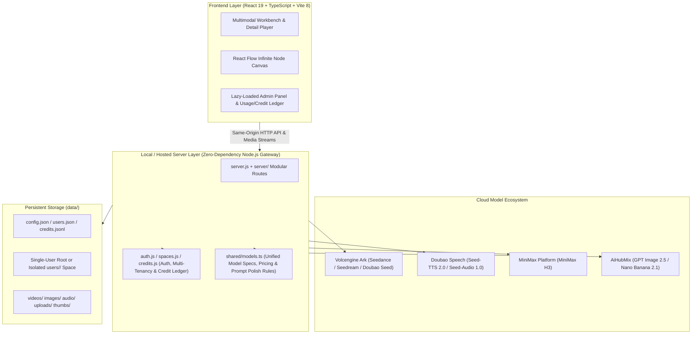

<div align="center">

<p align="center">
  <picture>
    <source media="(prefers-color-scheme: dark)" srcset="docs/screenshots/logo-dark.svg" />
    <source media="(prefers-color-scheme: light)" srcset="docs/screenshots/logo-light.svg" />
    
  </picture>
</p>

### A Local-First & Team-Ready Multimodal Generative AI Workbench
*Powered by Seedance 2.5/2.0, MiniMax H3, Seedream 5.0, GPT Image 2.5, Nano Banana 2.1, Doubao Speech & Infinite Node Canvas.*

[](LICENSE)
[](https://nodejs.org)
[](https://react.dev)
[](https://vitejs.dev)
[](https://reactflow.dev)

[English](README.md) | [简体中文](README.zh-CN.md)

[Features](#-features) • [Model Matrix](#-multi-platform--model-matrix) • [Quick Start](#-quick-start) • [Team Mode & Deployment](#-team-mode--deployment) • [Architecture & Storage](#-system-architecture--data-storage) • [Developer Guide](#-developer-guide)

</div>

---

> **Design Philosophy**: Workbench aesthetics inspired by Google Antigravity 2.0 and OpenAI Codex. **Native support for light and dark themes with automatic system-preference switching.** Clean sidebar navigation, a unified centered creation composer, low-contrast visual hierarchy, and system sans-serif typography keep the interface restrained and neutral so all visual focus stays on your generated content.

---

## 📸 Screenshots

> 🌗 **Adaptive Dual Theme**: The screenshots below automatically switch between light and dark modes based on your GitHub appearance settings.

<p align="center">
  <picture>
    <source media="(prefers-color-scheme: dark)" srcset="docs/screenshots/workbench-dark.png">
    <source media="(prefers-color-scheme: light)" srcset="docs/screenshots/workbench-light.png">
    
  </picture>
</p>
<p align="center"><em>Multimodal Creation Workbench: 5-in-1 composer for Video, Image, Speech, SFX, and Music alongside the recent generation feed</em></p>

<br />

<p align="center">
  <picture>
    <source media="(prefers-color-scheme: dark)" srcset="docs/screenshots/canvas-dark.png">
    <source media="(prefers-color-scheme: light)" srcset="docs/screenshots/canvas-light.png">
    
  </picture>
</p>
<p align="center"><em>Infinite Node Canvas (React Flow): Freeform topology across Text, Image, Video, and Audio nodes with @-mentions and reusable workflows</em></p>

---

## ✨ Features

### 1. 🌌 Infinite Node Canvas
- **Freeform Multimodal Topology**: Built on `@xyflow/react` with four native node types—**Text, Image, Video, and Audio**—allowing drag-and-connect pipelines to drive generation:
  - **Text ➔ Video / Image / Audio**: Pass text as generation prompts, or chain into downstream text nodes for expansion and refinement.
  - **Image ➔ Video**: Supply omni-reference images, start frames, or end frames.
  - **Image ➔ Image**: Multi-reference fusion and iterative image-to-image generation.
  - **Video / Audio ➔ Video**: Feed omni-reference assets (motion, camera work, pacing, or reference audio).
- **Prompt `@` Mentions & `/` Slash Presets**:
  - Type `@` in the canvas composer to insert connected upstream nodes (e.g., `@Image 1`, `@Text 1`) with inline highlighting; hover over reference chips to locate upstream nodes and edges bidirectionally.
  - Image nodes support `/` slash presets (multi-angle 3×3 grid, story progression 2×2 grid, character turnaround sheet, character design sheet, visual progression, cinematic lighting, and storyboard).
- **Video Continuation & Local Image Tools**:
  - **Video Nodes**: Extract the current frame, first frame, or last frame into a new image node with one click, or click "Continue Shot" to automatically grab the last frame and chain a new video node.
  - **Image Nodes**: Built-in interactive freeform/aspect-locked cropping, 2×2 / 3×3 / 4×4 grid slicing (ideal for splitting multi-shot grids), and aspect-ratio AI outpainting.
- **Group Execution, Workflows & Stack Organization**:
  - Box-select batch actions (batch generate, align/distribute, group `⌘G`, stack/collapse, and cross-canvas copy & paste);
  - Execute an entire group in topological order from upstream to downstream, or save a group as a reusable workflow across projects;
  - Four-color node tags with top-bar quick jump, automatic topological layout, and magnetic alignment guides.

### 2. 🎥 Multimodal Workbench
- **Cinematic Video Generation (Video)**:
  - **Seedance 2.5 / 2.0 / 2.0 Fast / 2.0 Mini** (Volcengine Ark): Supports text-to-video, first/last frame control, and omni-reference inputs (mix up to 9 images + 3 videos + 3 local audio clips). Seedance 2.5 supports up to 30-second clips; 2.0 supports up to 4K resolution.
  - **MiniMax H3 / H3 Max** (MiniMax Platform): Supports 480P / 768P / 2K video generation, first/last frame control, and omni-reference inputs.
- **Professional Image Generation (Image)**:
  - **Seedream 5.0 Pro / Flash / Standard** (Volcengine Ark): Supports 1K / 1.5K / 2K / 3K / 4K resolution tiers and up to 14 reference images.
  - **GPT Image 2.5 (Sunburst / Flare)** & **Nano Banana 2.1** (AiHubMix): Supports up to 4K resolution, multiple quality tiers, and up to 16 reference images.
- **End-to-End Audio Generation (Speech, SFX & Music)**:
  - **Natural Text-to-Speech (TTS)**: Powered by Doubao Speech Synthesis 2.0 (`Seed-TTS 2.0`), with built-in Chinese, English, and multilingual voice filtering and instant preview.
  - **Sound Effects (SFX)** & **AI Soundtrack (Music)**: Powered by Doubao Audio Generation 1.0 (`Seed-Audio 1.0`), supporting text-to-SFX or uploading a video to automatically score and preview synchronized audio-video playback.

### 3. 🎭 Character Library & Prompt Skills
- **Character Consistency Profiles**: Persistently store character names, appearance descriptions, and up to 6 reference images; inject references and traits into any prompt with a single click for multi-shot consistency.
- **Prompt Skills Library**: Ships with official skills ("Multi-Shot Sequence", "Character Concept Sheet", "Storyboard First Frame", etc.) plus custom skill creation and tag filtering.
- **Model-Adaptive Prompt Polish**: Powered by `Doubao Seed 2.1`, tailoring prompt rewrites to the active model's conventions (Seedance 2.5 timestamped shot breakdown, Seedance 2.0 camera & audio cues, Seedream image-to-image directives, TTS phrasing rules, and SFX/music descriptors) with one-click undo.

### 4. 👥 Local-First & Team Hosted Modes
- **Local Mode (Default)**: Zero external runtime dependencies and no login required. All configuration, generation history, and media assets are stored 100% locally in the `data/` directory.
- **Team Mode**: Creating user accounts via the CLI automatically enables authentication and multi-tenant workspace isolation:
  - **Data Isolation**: Each member's generation history, canvases, characters, skills, and media files are stored in isolated per-user spaces.
  - **Credit Accounting**: `1 credit = ¥0.01 CNY` (mapped 1:1 to official list prices). Credits are pre-authorized on submission, reconciled against actual token/second usage upon completion, and automatically refunded in full on failure.
  - **Role Separation**: "Settings" and "Admin" are strictly separated—API keys, third-party provider balances (Volcengine / MiniMax / AiHubMix), raw upstream errors, and member credit management are visible only to administrators.

---

## ⚖️ Multi-Platform & Model Matrix

Innate Studio centers on **Volcengine** while integrating **MiniMax** and **AiHubMix**. Provider API keys can be configured independently in the bottom-left **Admin** panel (or via environment variables)—enable whichever providers you need:

| Provider | Config Key / Env Variable | Capabilities | Supported Models |
| :--- | :--- | :--- | :--- |
| **Volcengine Ark** | `ARK_API_KEY` | Video generation, image generation, prompt polishing, canvas text nodes | `Seedance 2.5`, `Seedance 2.0 / Fast / Mini`<br>`Seedream 5.0 Pro / Flash / 5.0`<br>`Seed 2.1 Lite / Turbo / Pro` |
| **Doubao Speech** | `DOUBAO_SPEECH_API_KEY` | Text-to-Speech (TTS), Sound Effects (SFX), Video Music (Music) | `Seed-TTS 2.0`<br>`Seed-Audio 1.0` |
| **MiniMax** | `MINIMAX_CN_API_KEY` | Video generation (T2V, first/last frame, omni-reference) | `MiniMax H3`, `MiniMax H3 Max` |
| **AiHubMix** | `AIHUBMIX_API_KEY`<br>`AIHUBMIX_MANAGE_KEY` *(balance)* | Image generation (T2I, multi-image reference), account balance | `GPT Image 2.5 Sunburst`<br>`GPT Image 2.5 Flare`<br>`Nano Banana 2.1` |
| **Volcengine Billing** | `VOLC_ACCESS_KEY_ID`<br>`VOLC_SECRET_ACCESS_KEY` | Real-time Volcengine account balance query | — |

---

## 🚀 Quick Start

### Prerequisites
- **Node.js**: `>= 22.18` (the server runs the shared TypeScript model definitions `shared/models.ts` directly via native Node.js TypeScript support)

### Installation & Launch (Local Mode)

```bash
# 1. Clone the repository
git clone https://github.com/realruian/innate-studio.git
cd innate-studio

# 2. Install dependencies, build the frontend, and start the server
npm install
npm start
```

Once started, open **`http://127.0.0.1:5178`** in your browser. Click **Admin** in the bottom-left corner to configure your provider API keys.

> 💡 **Environment Variable Injection (Stateless Keys)**: If you prefer not to persist API keys in `data/config.json`, pass them via environment variables at launch:
> ```bash
> ARK_API_KEY=... DOUBAO_SPEECH_API_KEY=... MINIMAX_CN_API_KEY=... AIHUBMIX_API_KEY=... npm start
> ```
> To customize the listening port or data directory:
> ```bash
> PORT=5180 INNATE_DATA_DIR=/path/to/data npm start
> ```

---

## 👥 Team Mode & Deployment

When at least one user account exists in the data directory, the server automatically switches from **Local Mode** to **Team Mode**, requiring authentication to access the workbench.

### Account & Credit Management CLI (`npm run user`)

> ⚠️ **Note**: Stop the running server before modifying accounts via `npm run user`, or ensure account state stays synchronized. The initial administrator account must be created via the CLI.

```bash
# Create the first admin account and migrate existing local-mode data to this user
npm run user -- add alice --admin --with-local-data

# Create a regular member account (specify a password, or omit to generate a one-time initial password)
npm run user -- add bob --password <password>

# Grant credits to a member (100 credits = 1 CNY; negative values deduct credits)
npm run user -- grant bob 5000

# Reset a member's password
npm run user -- reset bob

# List all accounts, statuses, and credit balances
npm run user -- list
```

Once logged in, administrators can also create members, grant credits, reset passwords, or deactivate accounts directly from **Admin ➔ Members** in the bottom-left corner, as well as inspect total team credits and monthly usage.

### Production Server Deployment (`deploy/`)

Ready-to-use production configuration templates are provided under `deploy/`:
- [`deploy/env.example`](deploy/env.example): Environment variable template for server secrets (recommended at `/etc/innate-studio.env` with `chmod 600`).
- [`deploy/innate-studio.service`](deploy/innate-studio.service): `systemd` service unit with least-privilege sandboxing (`ProtectSystem=strict`, etc.).
- [`deploy/Caddyfile`](deploy/Caddyfile): Caddy reverse proxy and automatic HTTPS configuration (forwards to `127.0.0.1:5178` with a 70MB request body limit to support 64MB reference uploads).

---

## 🧱 System Architecture & Data Storage

### Architecture Overview



### Data Directory Layout (`data/`)

All application state is persisted inside `data/` (customizable via `INNATE_DATA_DIR`):

| File / Directory | Description |
| :--- | :--- |
| `data/config.json` | Provider API keys and billing configuration (environment variables take precedence) |
| `data/users.json` / `sessions.json` | Team-mode user accounts (salted `scrypt` password hashes) and active login sessions |
| `data/credits.jsonl` | Append-only credit transaction ledger (grants, pre-authorizations, settlements, refunds) |
| `data/users/<id>/` | Per-member isolated workspace in Team Mode (mirrors the single-user layout below) |
| `data/history.json` | Generation task history, parameters, token/credit usage, and status records |
| `data/canvases.json` | Infinite canvas projects (node topology, edges, groups, stacks, and viewport state) |
| `data/workflows.json` | Reusable node workflow templates saved from the canvas |
| `data/characters.json` | Character library profiles (names, appearance traits, and linked reference images) |
| `data/skills.json` | User-defined custom prompt engineering skills |
| `data/videos/` `images/` `audio/` | Automatically persisted video, image, and audio outputs |
| `data/uploads/` `thumbs/` | User-uploaded reference assets and automatically generated list thumbnails |

---

## 🛠️ Developer Guide

### Common Commands

```bash
# Start Vite frontend HMR dev server (proxies API requests to 127.0.0.1:5178)
npm run dev

# Run TypeScript type checking only
npm run typecheck

# Run the full automated test suite (typecheck, model & billing unit tests, canvas logic, API & team mode tests, CSS lint)
npm test

# Start a standalone mock environment on port 5179 (no real API keys or token spend required)
npm run dev:mock

# Run the automated light/dark full-page UI walkthrough script
npm run walkthrough
```

### Visual Walkthrough & Design System
This project follows strict UI and interaction guidelines (color tokens, 6-step type scale, spacing scale, and custom-drawn native-free controls). Please read **[DESIGN.md](DESIGN.md)** before modifying UI components or styles, and ensure `npm test` passes before committing.

---

## 📄 License & Acknowledgements

- Core source code is licensed under the [MIT License](LICENSE).
- Icons are provided by [Hugeicons](https://hugeicons.com/) (MIT License) and [Lucide](https://lucide.dev/) (ISC License), and the node canvas is built on [React Flow](https://reactflow.dev/) (MIT License). See [THIRD-PARTY-NOTICES.md](THIRD-PARTY-NOTICES.md) for details.
